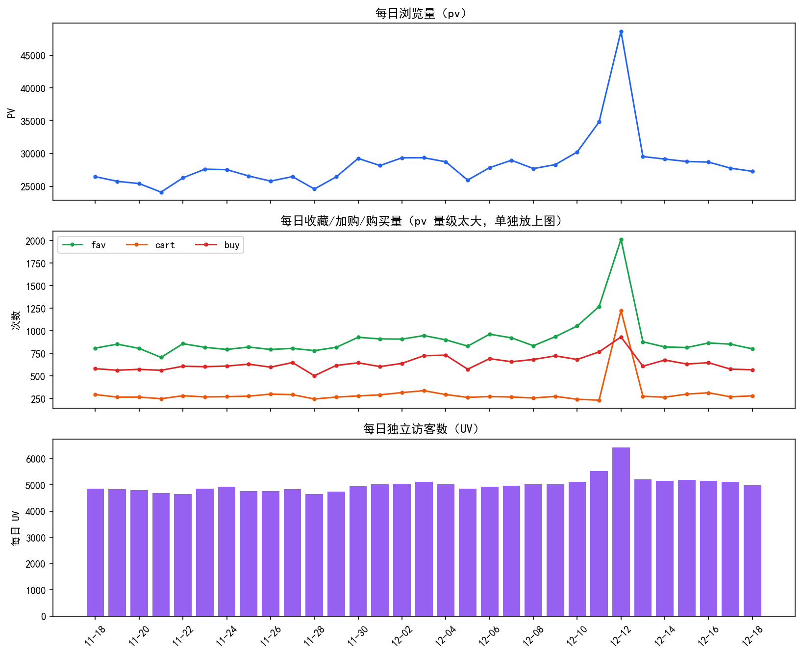
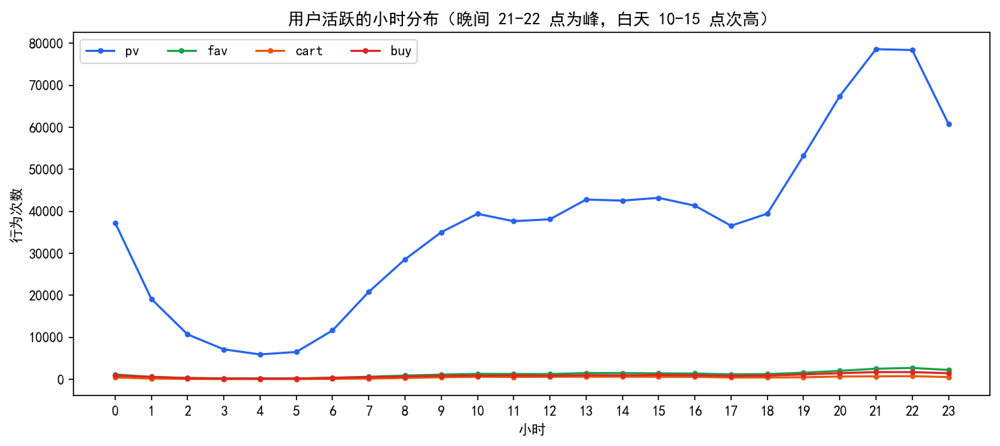
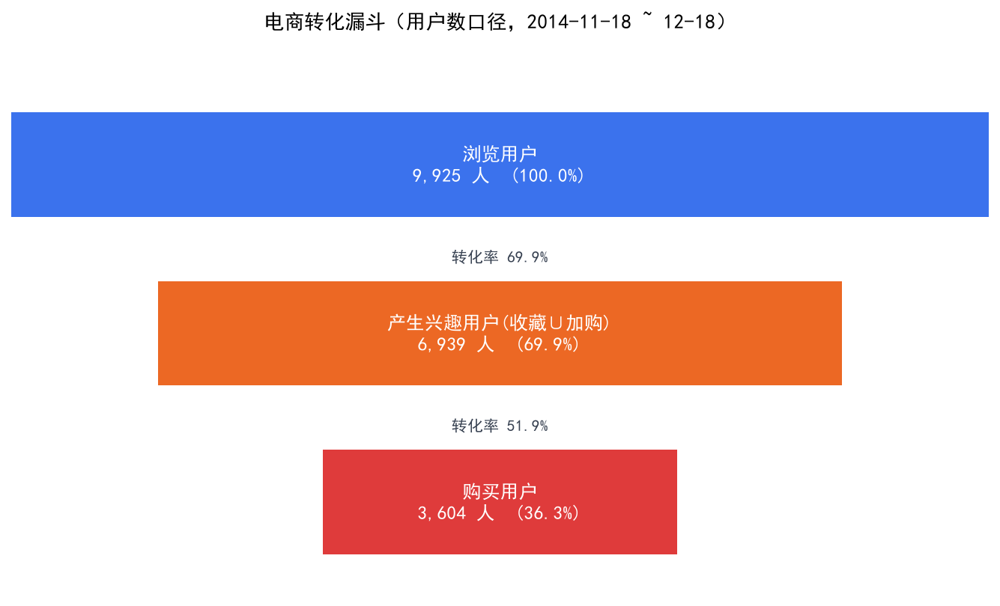
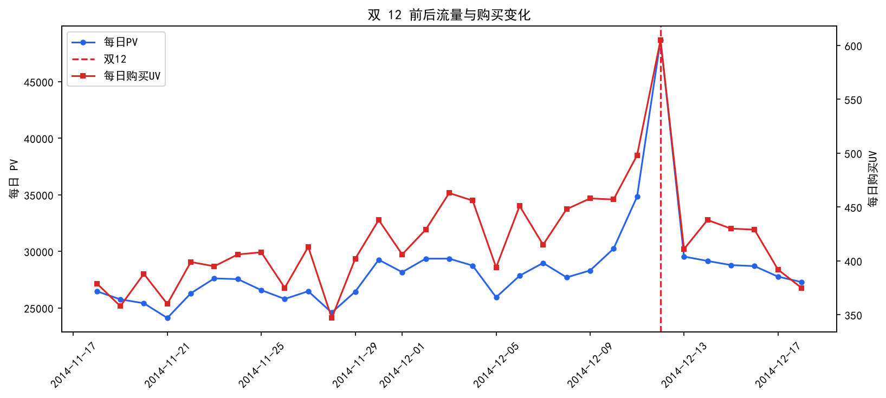
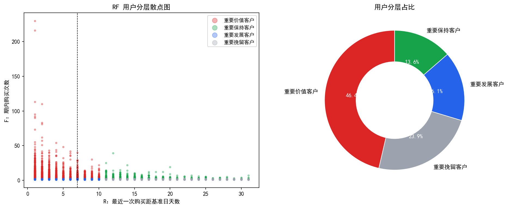

# 电商 App 用户行为分析（淘宝用户行为数据集）

## 项目简介

基于阿里天池公开的淘宝用户行为数据（原始 1225.7 万条，抽样 100 万条），完成从数据清洗、流量指标、转化漏斗到 RFM 用户分层的完整分析，并输出可落地的运营建议。

分析链条：**抽样清洗 → 流量/漏斗定位流失 → RFM 分层找运营抓手**。

## 数据说明

- 来源：阿里云天池「淘宝用户行为」数据集（https://tianchi.aliyun.com/ ，搜 UserBehavior）
- 原始规模：507MB CSV，**12,256,906 条**记录
- 时间跨度：**2014-11-18 ~ 2014-12-18**（31 天，含双 12 大促）
- 分析数据集：分块随机抽样 **100 万条** → 去重清洗后 **939,270 条**（9,929 名用户）

| 字段 | 说明 |
|---|---|
| user_id | 用户 ID |
| item_id | 商品 ID |
| item_category | 商品类目 ID |
| behavior_type | 行为类型：**1=pv 浏览 / 2=buy 购买 / 3=fav 收藏 / 4=cart 加购**（原始数据为数字编码） |
| user_geohash | 地理位置加密串，缺失率 68%，无分析价值，已丢弃 |
| time | 行为时间，精确到**小时**（格式 `yyyy-MM-dd HH`） |

## 目录结构

```
电商/
├── README.md
├── 01_数据抽样与清洗.ipynb    # 分块读取 1225.7 万条 → 抽样 100 万 → 清洗 → EDA
├── 02_流量与漏斗分析.ipynb    # PV/UV、浏览→兴趣→购买漏斗、加购流失、双 12 效应
├── 03_RFM用户分层.ipynb       # R/F 计算与打分、四象限分层、运营建议
├── sql/漏斗分析.sql           # MySQL 交叉验证脚本（建表导入 + 漏斗 + RFM）
├── data/                     # 抽样后的分析数据集（体积较大，不入库，见“复现步骤”）
└── figures/                  # 输出图表
```

## 分析流程

1. **数据抽样与清洗**：1200 万条无法一次读入内存 → 分块读取 + 按比例随机抽样（种子 28，可复现）→ 时间解析、数字编码转名称、去重
2. **流量与漏斗**：PV / UV / 人均浏览；用户口径漏斗（浏览 → 收藏∪加购 → 购买）；细分路径定位流失环节；双 12 大促对比
3. **RFM 分层**：以购买记录计算 R（距基准日天数）、F（购买次数），按分位数打 1-5 分、以中位数切分四类用户
4. **业务建议**：针对四类用户给出差异化运营动作 + MySQL 交叉验证

## 关键结论

| 指标 | 结果 |
|---|---|
| 用户口径漏斗 | 浏览 9,925 → 兴趣（收藏∪加购）6,939（**69.9%**）→ 购买 3,604（**51.9%**） |
| 最大流失环节（转化侧） | **加购 → 购买仅 44.9%**，2,517 人（55.1%）加购后未购买 |
| 最大流失环节（流量侧） | 浏览 → 兴趣流失约 30%，3,200 余人未产生任何互动行为 |
| 纯浏览用户 | 2,195 人（占 22.1%），人均浏览 26.7 次 |
| 双 12 效应 | 当天 PV 48,678，为日常均值 **1.8 倍**；购买 UV 605 人 |
| RFM 分层 | 重要价值 46.4% / 重要挽留 23.9% / 重要发展 16.1% / 重要保持 13.6% |

**业务建议要点**

- 加购用户是高意向人群，55% 未下单 → 降价提醒、限时券、弃购召回，ROI 最高；
- 浏览 → 兴趣环节靠产品侧优化（推荐位、主图、详情页），不是运营能解决的；
- 重要挽留客户（23.9%）买过就流失，用低成本券召回，别做高成本触达。

## 关键图表

| 图 | 说明 |
|---|---|
|  | 每日 PV / 收藏加购购买 / UV，12-12 冲高 |
|  | 用户活跃时段：晚间 21-22 点为峰 |
|  | 用户口径漏斗与各环节转化率 |
|  | 双 12 前后 PV 与购买 UV 变化 |
|  | 四类用户占比与 R/F 分布 |

## 复现步骤

原始数据 507MB、抽样数据 30MB 均不入 git，需要按下面步骤自行生成：

1. 到天池下载「淘宝用户行为」数据集，把 `淘宝用户行为.csv` 放到项目根目录；
2. 运行 `01_数据抽样与清洗.ipynb` → 生成 `data/userbehavior_1m.csv`（100 万条）；
3. 再运行 `02`、`03`（两者读取上一步生成的 CSV，清洗口径与 01 一致）；
4. （可选）MySQL 交叉验证：
   ```bash
   SET GLOBAL local_infile = 1;                                          -- 先开开关
   mysql -uroot -p --local-infile=1 < sql/漏斗分析.sql
   ```
   两点注意：① 脚本里的 `LOAD DATA` 路径要改成你自己的实际路径；② **Windows 下 MySQL 读不了含中文的路径**（报 errno 2），把 CSV 复制到纯英文目录再导入即可。脚本执行后可用 `SELECT COUNT(*) FROM taobao.user_behavior;` 校验，应为 **939,270** 条、漏斗 9,925 → 6,939 → 3,604。

## 环境

- Python 3.12+（pandas / numpy / matplotlib / jupyter）
- MySQL 8.x（可选，用于 SQL 交叉验证）

## 已知局限

- 时间窗只有 31 天且刻意包含双 12，大促效应被放大，结论不宜外推到全年；
- 该数据集为**高活跃用户子集**（人均浏览 89 次，远高于全站水平），结论侧重相对比较；
- 数据无金额字段，RFM 的 M 维无法计算，退化为 R/F 二维分层。

## 写在最后

加购完其实也不等于快买了，有 55% 的人加购完就走了，可以加点优惠券引导购买；
分层完发现“重要挽留客户”数量第二多，比想象的多。
